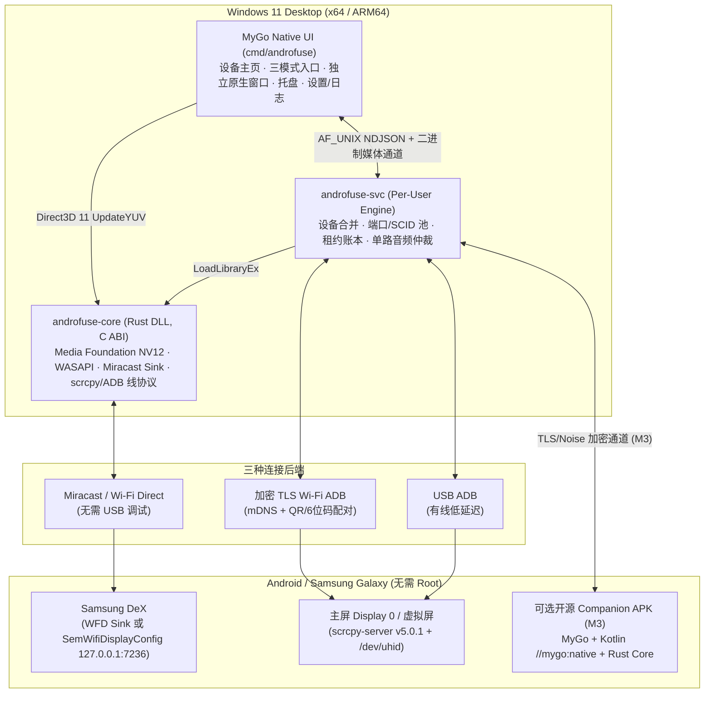

# PLAN：AndroFuse 技术架构与完整项目计划

> 文档日期：2026-11-23  
> 项目名称：**AndroFuse**；图标：`resources/icon.svg`（原根目录 `AndroFuse-icon.svg` 已规范迁入）；许可证：**GPL-3.0-only**。  
> 本文已完整融合原需求文档的全部目标、边界、安全约束与验收标准，作为开发阶段的唯一权威实施蓝图；长期稳定的架构契约与平台实测记录同步维护在 `doc/en-us/` 与 `doc/zh-cn/`。

---

## 0. 项目目标与核心决策

开发一款开源、现代化的 Windows Android 桌面集成客户端，以停更的 **Samsung DeX for PC** 的替代与增强为核心，同时兼容三星 DeX 设备及普通 Android 设备。优先实现稳定、低延迟、易用的本地连接，**全程无需 Root**，不得通过削弱 Android 或 Windows 系统安全性来实现兼容。

| 决策维度 | 工程决策 | 说明与依据 |
|---|---|---|
| 前端与桌面框架 | **MyGo `v0.10.0` 原生 UI**（`package ui`，Windows 启用 `mygo_nowebview`） | 纯 Go + GPU（Direct3D 11）渲染，支持 `ui.Bitmap.UpdateYUV` NV12 硬解直出与多独立原生窗口；零 WebView / JS 视频帧转发 |
| 桌面与移动统一架构 | **参照 Kyokai `v0.8.1` 双端同仓模型** | 同一仓库构建 Windows 桌面端（`cmd/androfuse` + `cmd/androfuse-svc`）与可选 Android Companion APK（M3 `internal/androidhost`），共用 Go 状态模型与 Rust 核心库 `core/androfuse-core` |
| 操作系统支持 | **Windows 11 `x64` 与原生 `ARM64`**（同等首版硬门槛）；Windows 10（`19045+`）在 M4 评估并实测 | 不得以 `x64` 转译运行宣称 `ARM64` 支持；自检模块内置 `IsWow64Process2` 检测 |
| Android 支持范围 | Android 11–17（基础镜像与独立窗口）；Samsung DeX 重点覆盖 One UI 5.1–9；Companion APK 目标 `minSdk 26` / `arm64-v8a` / 16 KB 对齐 | 与 MyGo `v0.10.0` 及 `scrcpy v5.0.1` 能力对齐 |
| 整体开源许可证 | **GPL-3.0-only**（与 `Easytier-MyGo`、`Nextcloud-MyGo`、`WSLPilot`、`Kotomo` 一致） | 兼容 MIT（MyGo、DeXDesk、DX-Manager、MyDeX）、Apache-2.0（scrcpy、ScrcpyDeX、adb）、BSD-3-Clause 与 GPL-3.0-or-later（DeXter）；绝不直接复制 AGPL 或商业闭源源码 |
| 上游安全边界 | 仅作设计参考：`AndroMeld` | **严禁**反编译、复制或重分发 `AndroMeld` 的商业 APK、字节码、源码或资源 |

---

## 1. 参考项目源码、许可证与技术调研

以下结论均基于 2026-11-23 对各项目最新公开仓库与本地 `Kyokai`（已拉取至 `01321d7` / `0.8.1`）的实际核查：

| 项目 | 核查版本 | 许可证 | 语言 | 核心技术方案与可复用能力 | 已知限制与规避点 |
|---|---|---|---|---|---|
| **MyGo** (`egoist/mygo`) | `v0.10.0` | MIT | Go | 原生 D3D11 UI、`ui.Bitmap.UpdateYUV`（NV12/I420 GPU 着色器直转 RGBA，零 CPU 色彩转换）、`MYGO_UNCAPPED` 低延迟帧调度、`mygo_nowebview`、Android `//mygo:native` Kotlin 模块 | Windows ARM64 走 D3D11；多窗口高频 `UpdateYUV` 调度需在 Spike S1 实测 |
| **Kyokai** (`YuanZhe-99/Kyokai`) | `v0.8.1` | AGPL-3.0-only | Go + Rust + Kotlin | 桌面 + Android 同仓结构、`internal/core`（`LoadLibraryEx` + `purego` + 堆 `outSlot`）、`androfuse-svc` 子进程模型、`tools/checkdocs`、自适应图标与 16 KB APK 打包 | 本项目采用 `GPL-3.0-only`，**不得**复制 Kyokai 中 AGPL 的 RustDesk 衍生 crate |
| **scrcpy** (`Genymobile/scrcpy`) | `v5.0.1` | Apache-2.0 | C / Java | `scrcpy-server-v5.0.1` 协议、硬件编码流（H.264/HEVC/AV1）、`--new-display`、`--flex-display`（动态改虚拟屏尺寸）、`--start-app`、`/dev/uhid` 物理键鼠、熄屏投屏、原生 `win64` + `winarm64` 构建 | 普通 `--new-display` 在 One UI 7–8.5 上不是完整 DeX；单设备硬件编码器并发数量有限 |
| **DeXDesk** (`adirh3/DeXDesk`) | `v0.1.1` | MIT | Rust | Wi-Fi Direct Sink：`WiFiDirectAdvertisementPublisher` + `WFDOpenHandle` + `wlanapi.dll!WlanNotifyVsIeProviderInt`（GUID `b7d94b4d-5db1-4e70-b5c3-dd003eeebe66`），RTSP 协商、RTP/MPEG-TS H.264 Media Foundation 硬解、UIBC 输入 | `WlanNotifyVsIeProviderInt` 为 Windows 未公开入口；实测手机常锁定 30 FPS；Miracast 拒绝原生 HID 鼠标（右键需 720ms 长按模拟、滚轮转触摸滑动）；v0.1.1 无音频；与系统“无线显示器”抢占端口 |
| **ScrcpyDeX** (`Aureliano021/ScrcpyDex`) | `v2.1.0` | Apache-2.0 | C# + Java | `scrcpydex-server.jar`（`app_process` UID 2000，无 Root）反射调用三星 `SemWifiDisplayConfig$Builder` 启动 `127.0.0.1:7236` 无线 DeX 本地回环，拿真实 `display_id` 后用 `scrcpy --mouse=uhid` 投出；`ACTION_STOP_DESKTOP_MODE` 广播恢复；Win32 Job Object 防孤儿 | 依赖三星固件保留 `SemWifiDisplayConfig`；必须开启 ADB（USB 或无线） |
| **DX-Manager** (`maze-mei/DX-Manager`) | `v3.0.1` | MIT | C# + Kotlin | 多手机会话注册、One UI 版本探针（`ro.build.version.oneui`/`sem`）、Native DeX 30 秒断线宽限复用、DPI ≥ 160 初始化规则、独立应用槽位、`overlay_display_devices` 回退、可选 `DX Companion` 负责手机→PC 传输与异常显示清理 | Native DeX 已在 One UI 9 / Android 17 验证；老版本或非标准固件需走回退路径并给出诊断证据 |
| **MyDeX** (`Keremerk/MyDeX`) | `v0.3.0` | MIT | C# | 验证了 One UI 7/8.5 下 `--new-display` 的边界：普通虚拟屏下 DeX 最近任务（`|||`）为空且应用强制全屏；揭示 Android 全局音频单流归属与 `adb tcpip` 明文风险 | 普通 `--new-display` 只能作“虚拟桌面回退”或“独立 APP 窗口”，不可冒充完整 DeX |
| **DeXter** (`fabriciolima77/DeXter`) | `v0.5.0` | GPL-3.0-or-later | C# + Java | 备用研究参考：融合 `ScrcpyDeX` 回环、`overlay_display_devices` 兼容模式及会话中途 USB 拔线转 Wi-Fi 续接 | 仅单托盘入口且为葡萄牙语；思路可供 M2 借鉴 |
| **AndroMeld** (`catchingnow`) | 商业闭源 | 专有 | Web + Android | 独立 APP 窗口交互、无感配对码、双向剪贴板、文件拖放与音频融合的用户体验标杆 | **严格禁止源码/APK 逆向或重分发** |

---

## 2. 「功能 × 连接方式 × Android/One UI × Windows 架构」兼容性矩阵

> **诚实标注原则**：`[上游源码/规范证实]` 表示已有明确源码/文档依据但仍需在本项目真机复验；`[待实机 Spike 验证]` 表示 M1/M2 真机测试前不得标记为“已支持”；`[系统/架构限制]` 表示已确认的平台约束。

| 功能模式 | 连接方式 | One UI 5.1–6.1.1（Android 13–14） | One UI 7（Android 15） | One UI 8 / 8.5 / 9（Android 16–17） | 普通 Android 11–17（非三星） | Windows 11 x64 / 原生 ARM64 |
|---|---|---|---|---|---|---|
| **Samsung DeX 完整桌面（无线 Miracast — 已隐藏搁置）** | Wi-Fi Direct / Miracast | `[已隐藏搁置]` 依赖微软未公开私有接口 `wlanapi.dll!WlanNotifyVsIeProviderInt` | `[已隐藏搁置]` 同左 | **`[已隐藏搁置]`** 真机复测证实第三方调用未公开 `WlanNotifyVsIeProviderInt` 在高通 `qcwlan8280.sys`（`1.0.4122.4000` WiFiCx）关联时触发内核 `BugCheck 0x0000007E`（`0xC0000005`） | `[系统限制]` 不适用 | **全平台隐藏禁用**（拒绝依赖未公开且可致系统蓝屏的私有驱动接口；无线 DeX 统一由加密 TLS Wi-Fi ADB Native DeX 承担） |
| **Samsung DeX 完整桌面（ADB 原生回环）** | USB / TLS Wi-Fi ADB（`SemWifiDisplayConfig` `127.0.0.1:7236`） | `[上游证实]` SDK 30+ 存在该 API（需确认旧版 One UI 多窗口/指针行为） | `[上游证实]` 替代停更官方 DeX for PC 的主力方案 | **`[本仓 Fold 8 真机已验证]`** One UI 9.0 / Android 17 有线 USB 与加密 TLS Wi-Fi ADB 均实测通过（1080p60、DXVA 硬解、鼠标悬停/右键/滚轮/动态缩放） | `[系统限制]` 不适用（检测非三星或无 `SemWifiDisplayConfig` 时拒绝并提示回退） | **`windows/arm64` 已真机验证通过**，`x64` 待 M4 真机验证（纯 TCP/ADB 转发，零未公开无线驱动崩溃风险） |
| **DeX 桌面回退方案（虚拟/模拟显示）** | USB / TLS Wi-Fi ADB（`--new-display` 或 `overlay_display_devices`） | `[上游证实]` `overlay_display_devices` 可触发完整 DeX（手机端有悬浮窗） | `[上游证实]` `--new-display` 无任务栏/最近任务；`overlay_display_devices` 保留多窗口 | `[上游证实]` 仅作兼容回退，UI 明确标注“兼容/虚拟桌面模式，非完整原生 DeX” | `[可用]` 启动 AOSP 自由窗口桌面模式（非 DeX） | **x64 与原生 ARM64 均可用** |
| **Android 手机主屏镜像（Display 0）** | USB / TLS Wi-Fi ADB（`scrcpy-server v5.0.1`） | `[上游证实]` 60+ FPS、音频、剪贴板、熄屏投屏均可用 | `[上游证实]` 同左 | `[上游证实]` 同左（DRM/`FLAG_SECURE` 应用呈黑屏提示） | `[上游证实]` 全面兼容 Android 11–17 | **x64 与原生 ARM64 原生支持**（Media Foundation DXVA NV12 硬解） |
| **独立 APP 原生窗口（每应用独立窗口）** | USB / TLS Wi-Fi ADB（`--new-display` + `--flex-display` + `--start-app`） | `[待实机验证]` 支持独立虚拟显示；旧系统动态 resize 表现待测 | `[待实机验证]` 单应用隔离可行；不占用手机主屏 | `[上游证实]` `scrcpy v5.0.1` `--flex-display` 支持 Snap Layouts 动态调分辨率；硬件编码器并发上限约 2–4 路（待 Spike S4 实测） | `[上游证实]` 支持 Android 11+（`resizeableActivity=false` 或系统独占应用除外） | **x64 与原生 ARM64 原生支持**（Win32 独立窗口、任务栏、Alt+Tab、Snap Layouts） |

### Windows 10 兼容性评估范围（M4 定论）
- **Media Foundation + Direct3D 11 + ADB**：Windows 10 22H2 (`19045+`) 具备基础能力（MyGo 自动回退无 Mica 材质）；
- **Miracast Wi-Fi Direct Sink**：Windows 10 部分旧版无线网卡驱动缺少 NDIS 6.3+ / WDDM 1.3+ 接收能力或 `WlanNotifyVsIeProviderInt` 行为差异，将在 M4 实测后明确标注“支持/有条件支持/不支持”，不预先承诺。

---

## 3. 系统安全与工程不变量（`INV-01` – `INV-13`）

编码 Agent 必须将以下不变量落实为架构边界、运行时检查或自动化测试：

| 编号 | 不变量 | 约束说明 |
|---|---|---|
| `INV-01` | **三模式架构零人为互斥** | Samsung DeX、手机镜像、独立 APP 窗口可同时存在（例如：物理手机正常使用 + DeX 窗口 + 2 个独立 APP 窗口，或手机镜像 + 独立 APP 窗口）；仅在硬件编码器上限、单路音频独占或系统策略冲突时探测提示并安全回退 |
| `INV-02` | **单设备集中资源仲裁** | 同一物理设备（合并 USB 序列号与 TLS Wi-Fi ADB 地址）由 `androfuse-svc` 集中管理 ADB 连接、端口转发池、唯一 `scid`、音频归属切换与焦点路由，严禁多窗口各自拉起冲突的 `adb` 进程 |
| `INV-03` | **虚拟显示与 UHID 租约账本** | 每次创建虚拟显示、`SemWifiDisplayConfig` 回环、`overlay_display_devices` 或 `/dev/uhid` 设备前持久化写入 `leases.json`；正常退出、断线重连或进程崩溃重启时自动回收残留状态，禁止手机端遗留“幽灵屏幕” |
| `INV-04` | **零 JS 视频帧转发与零每帧分配** | 所有视频解码通过 Windows 原生 Media Foundation（硬解优先，软解显式回退）输出 NV12 平面直接送入 MyGo D3D11 `ui.Bitmap.UpdateYUV`，热路径零 `image.RGBA` 拷贝、零 GC 抖动、零 WebView/JS 转发 |
| `INV-05` | **诚实性能遥测** | 界面严格区分「目标设置（如 1080p60 / 120 FPS）」与「实际协商分辨率、实测解码/渲染 FPS、解码耗时 ms、当前运行方案（Miracast / ADB Native DeX / Virtual Display Fallback）」 |
| `INV-06` | **真伪 DeX 严格区分** | 激活 DeX 后必须校验桌面启动器包、任务栏、Freeform 多窗口能力与最近任务可用性；无法提供完整 DeX 时明确提示当前处于虚拟/模拟回退模式，绝不以普通虚拟桌面冒充完整 Samsung DeX |
| `INV-07` | **加密无线优先与最小暴露面** | 无线 ADB 优先使用 Android 11+ TLS 配对（`_adb-tls-pairing._tcp` / `_adb-tls-connect._tcp`）；旧式明文 `adb tcpip` **默认禁用**，启用需单独风险警告与二次确认，退出时提供一键切回 USB；远程访问与 MCP 控制**默认关闭** |
| `INV-08` | **凭据本地加密与诊断脱敏** | 配对凭据与密钥仅存本地（Windows DPAPI / Android Keystore），绝不写入明文日志或随诊断包泄漏；日志导出默认脱敏设备序列号、局域网 IP、用户主目录与剪贴板内容 |
| `INV-09` | **安全边界零妥协** | 不要求 Root，绝不绕过 `FLAG_SECURE`/DRM 或 Android 沙箱限制；遇到受保护画面显示明确的「受版权/安全策略保护（DRM）」提示；Companion 增强权限（通知、无障碍、Shizuku）采用分级显式授权且可随时关闭 |
| `INV-10` | **原生 ARM64 硬门槛** | `windows/arm64` 构建中的所有 EXE、DLL、捆绑 `adb` / 工具链均须为纯原生 ARM64 PE，CI 自动校验并内置运行时 WOW64 转译告警 |
| `INV-11` | **基础能力零 APK 依赖** | 基础 Miracast DeX 无需开启 USB 调试且无需 APK；基础 USB/Wi-Fi ADB 镜像、ADB Native DeX 与基础独立窗口无需安装 Companion APK；仅在触发增强能力时引导安装并取得用户授权 |
| `INV-12` | **窗口级输入焦点隔离** | 多窗口并发时按窗口句柄 → `scid` / `display_id` 精确路由键鼠；Miracast 仅在指针位于画面区域且窗口激活时投递 UIBC，保留 Windows `Alt+Tab` / `Win` 快捷键；提供紧急释放组合键（`Ctrl+Alt+Esc`） |
| `INV-13` | **开源合规与商业隔离** | 完整保留第三方开源署名与许可证文本；严禁复制或重分发 `AndroMeld` 商业代码或 APK |

---

## 4. 模块化系统架构、FFI 与 IPC 契约

### 4.1 模块拓扑

### 4.2 八大模块职责边界

| 模块 | 位置（M0–M3 渐进落地） | 负责内容 | 禁止跨越边界 |
|---|---|---|---|
| **MyGo UI** | `internal/gui` | 设备主页、三模式切换、独立应用窗口管理、悬浮状态 HUD、系统托盘、设置/日志/自检与自动更新 | 不直接调用 `adb.exe` 命令行或维护底层 socket |
| **设备与会话管理** | `cmd/androfuse-svc` + `internal/engine` | 统一设备表（USB/Wi-Fi 序列号合并）、会话生命周期、单设备多路视频/单路音频仲裁、`leases.json` 崩溃回收 | 不负责 UI 布局与像素渲染 |
| **传输层** | `internal/transport` + `androfuse-core` | USB ADB、TLS Wi-Fi ADB（QR/配对码/mDNS）、Miracast Wi-Fi Direct 发现配对与 USB↔Wi-Fi 自动热切换 | 不关心上层是 DeX 还是单应用窗口 |
| **DeX 引擎** | `internal/dex` + `server/`（Java `app_process`） | Miracast DeX 协商、ADB `SemWifiDisplayConfig` 回环激活、One UI 探针、DeX 完整性校验与虚拟显示安全回退 | 不强迫普通 Android 设备伪装 DeX |
| **镜像引擎** | `internal/mirror` | Display `0` 投屏、熄屏控制（`SET_DISPLAY_POWER`）、横竖屏跟随、PNG 截图、无重编码 MP4 录屏 | 不侵入 DeX 专属广播控制 |
| **独立 APP 引擎** | `internal/appwin` | `--new-display` / `--flex-display` / `--start-app` 调度、Win32 任务栏 `AppUserModelID` 与图标映射、Snap Layouts 自适应重调分辨率、单实例迁移与关闭恢复策略 | 不把单个 APP 窗口与物理手机主屏幕锁死 |
| **原生音视频渲染** | `core/androfuse-core` + `ui.Bitmap.UpdateYUV` | H.264/HEVC Media Foundation DXVA NV12 硬解、软解回退（带提示）、WASAPI 音频播放、真实 FPS 与解码耗时统计 | 禁止每帧堆分配或 JS 中转 |
| **Android Companion** | `internal/androidhost`（M3） | 应用图标清单、通知同步回复、双向剪贴板协助、SAF 文件传输/拖放、电量/温控状态、应用接力、断线显示回收 | 基础镜像与 Miracast 不得强依赖 APK |

### 4.3 C-ABI 与本地 IPC 规划
- **M0 已落地 ABI v1**：`androfuse_abi_version() -> u32`、`androfuse_start`、`androfuse_call`、`androfuse_free`、`androfuse_stop`（已包含真实 `diagnostics.self_check`）。
- **M1 扩展 ABI v2（媒体零拷贝路径）**：增加 `androfuse_decoder_open`、`androfuse_decoder_decode_yuv`（直接填充借用 NV12 平面供 Go `ui.Bitmap.UpdateYUV` 零拷贝上传 D3D11 纹理）、`androfuse_decoder_info`、`androfuse_decoder_close` 与 `androfuse_audio_*`。
- **GUI ↔ `androfuse-svc` 本地 API**：沿用 Kyokai 已验证的 Windows AF_UNIX NDJSON 协议（`SIO_AF_UNIX_GETPEERPID` 校验同用户身份），状态快照节流推送，不阻塞主线程。

---

## 5. 三种工作模式详细设计与并存方案

### 5.1 模式一：Samsung DeX 桌面
1. **有线 + 加密无线 ADB 双通道与安全回退（Miracast 因依赖未公开接口已隐藏）**：
   - 设备通过 **有线 USB ADB** 或 **加密 TLS Wi-Fi ADB（`_adb-tls-connect._tcp`）** 连接且检测为支持 `SemWifiDisplayConfig` 的三星设备 → 默认走 **ADB Native DeX 回环**（支持真 60 FPS、原生鼠标悬停/右键/滚轮、动态缩放、音频与剪贴板，零未公开 Windows 无线驱动崩溃风险），同时允许手动切换至 **虚拟/模拟显示回退**；
   - **Miracast 方案已全平台隐藏搁置**：第三方 Windows Miracast Sink 必须调用未公开私有接口 `wlanapi.dll!WlanNotifyVsIeProviderInt`，真机实测引发 `qcwlan8280.sys` 内核 `BugCheck 0x0000007E` 蓝屏，故不在界面暴露或运行期启用。
2. **完整 DeX 验收探针**：启动后校验三星设备身份与 `SemWifiDisplayConfig` 活跃桌面显示、多窗口 Freeform 调整、底部任务栏、最近任务（`|||`）和右键/滚轮/悬停行为；若仅能以 `--new-display` 启动虚拟桌面，UI 必须明确标识为「虚拟桌面兼容模式」（`INV-06`）。

### 5.2 模式二：Android 手机主屏镜像
- 基于 `scrcpy-server v5.0.1` Display `0`；
- 支持：USB / TLS Wi-Fi ADB、UHID 真键盘鼠标或触控模拟切换、设备音频透传、双向剪贴板同步、横竖屏自适应窗口大小、无边框全屏、PNG 截图与直存 MP4 录屏；
- **亮屏 / 熄屏投屏开关**：通过 `SET_DISPLAY_POWER` 熄灭物理面板同时保持系统未锁屏（提示用户不要按物理电源键以免连带锁屏 DeX），断开时自动恢复亮屏。

### 5.3 模式三：独立 APP 原生窗口（已对标 AndroMeld 在 `Pixel_9a_API_36` 完成重构验证）
1. **真实应用图标与名称提取器（无需等待 APK 亦可工作）**：`server/dexhelper` `apps` 子命令（`ActivityThread.systemMain()` + `PackageManager` + `96x96` PNG 渲染）提取真实本地化应用名称、`resizeMode` 与高清 PNG 图标并过滤 WebAPK/十六进制哈希噪声；`internal/dex.ListAppsWithIcons` 落盘缓存并在 `internal/gui` 以 **独立应用启动器网格（App Launcher Grid）** 呈现，单点即刻启动；
2. **无系统边框纯应用融合窗口（`vd_system_decorations=false`）**：默认以 16 像素对齐的 `640x1120/220` 竖屏比例启动 `scrcpy-server v5.0.1`（隐藏虚拟屏 Android 状态栏、导航栏与桌面壁纸），动态缩放按 `1.5×` 像素倍率（`16 px` 对齐）同步至 `TYPE_RESIZE_DISPLAY` 以保持清晰桌面级密度，通过 `TitleBarHidden` 将应用图标、应用名、返回/旋转/截图/录屏/静音与 Windows Snap Layouts 最大化按钮融入原生标题栏；
3. **多窗口并发、Snap Layouts 与单实例迁移**：拖动或 Windows Snap Layouts 改变原生窗口宽高时按 `16 px` 对齐并防抖触发 `TYPE_RESIZE_DISPLAY`；通过 `+pkg` 避免与手机主屏锁死，并在启动器提示不可自由缩放应用（后续 M3 Companion 补充「迁回主屏」接力）。

### 5.4 三模式并存真值表
- **主屏镜像 + 独立 APP 窗口（≥2 个）**：允许并存，音频默认跟随当前激活或用户指定的窗口。
- **ADB Native DeX + 独立 APP 窗口**：允许并存（各自占用独立 `display_id` 与编码通道），当总虚拟显示数接近手机硬件编码器上限（Spike S4 探测）时给出警告并阻止静默黑屏。
- **Miracast DeX + ADB 独立 APP 窗口**：技术上可并存（无线 WFD 编码器 + 1–2 路 `scrcpy` 编码器），开启前探测编码器余量并提示延迟/带宽权衡。

---

## 6. 连接后端、自检诊断与音视频管线

1. **三后端统一接入**：
   - **Miracast / Wi-Fi Direct**：动态探测 `wlanapi.dll` 与设备无线状态；若检测到系统自带“无线显示器”占用端口 `7236` 或驱动不支持，自检向导直接给出可执行排查提示。
   - **TLS Wi-Fi ADB**：内嵌 mDNS 监听 `_adb-tls-pairing._tcp` 与 `_adb-tls-connect._tcp`，提供“扫码配对”和“6 位配对码”两种引导；USB 插入后支持“一键转为加密无线 ADB”。
   - **USB ADB**：自动识别厂商提示与授权对话框引导；不支持时诊断驱动/线缆（例如仅充电线缆速率或连接失败）。
2. **自动重连与热切换**：记录设备物理硬件序列号关联；USB 意外拔线时在 30 秒宽限期内尝试切至同设备的已配对 TLS Wi-Fi ADB 续接 DeX 或虚拟显示会话（防止重新登录或丢失应用状态）。
3. **原生视频解码与渲染**：Rust 核心直接调用 Windows Media Foundation `IMFTransform`（DXVA2/D3D11 硬件解码输出 NV12），经零拷贝切片传给 MyGo `ui.Bitmap.UpdateYUV` 由 Direct3D 11 渲染着色器完成色彩空间转换与显示；硬件解码失败时明确回退软解并在 HUD 标注 `[SW]`。
4. **异网与 5G 远程连接架构（手机 Companion App + 用户自有 VPN / EasyTier 组网，M3–M4 规划）**：
   - **场景 A：不同 Wi-Fi / 跨子网 + VPN 或 EasyTier**：原生 Android 无线调试（`_adb-tls-connect._tcp`）在切换 Wi-Fi 后随机分配端口。已提前配对密钥的情况下，Android Companion APK（M3）在手机端通过 `NsdManager` 监听本机 `_adb-tls-connect._tcp` 端口变化，并通过 VPN/EasyTier 加密隧道将最新 `<vpn_ip>:<tls_port>` 告知桌面端，直接驱动完整 `scrcpy v5.0.1`、独立 APP 窗口与 **ADB Native DeX**（M1b 桌面端现已支持直接输入 VPN/EasyTier `host:port` 连接）；
   - **场景 B：纯 5G 蜂窝网络（无 Wi-Fi，无 Root）**：诚实受限于 Android 系统策略（原厂非 Root `adbd` 无线调试要求 `TRANSPORT_WIFI` 网络接口，纯蜂窝链路下原生 `adbd` 无线调试不可开启）；因此纯 5G 场景由手机 Companion APK 通过用户自有 VPN（Tailscale/WireGuard）或 **EasyTier 组网**建立原生 `MediaProjection` + `MediaCodec` H.264/HEVC 视频通道与分级授权 `AccessibilityService` 触控回传通道（全程不绕过 `FLAG_SECURE`/DRM，`INV-09`）；
   - **EasyTier `--no-tun` 用户态避让设计**：由于 Android 仅允许同时激活一个系统级 `VpnService`，`core/androfuse-core` 集成的 EasyTier 以 **用户态（`--no-tun` + 局部代理/端口映射，不接管全局 `VpnService`）** 运行且默认关闭（`INV-07`），既允许用户继续保留原有 WireGuard/Tailscale/校园 VPN，也可零冲突实现 P2P UDP 打洞直连或私有节点中继，并在广域网高抖动下按 RTT/丢包自适应调节码率与 `TYPE_RESET_VIDEO` IDR 恢复。

### 6.5 Android 模拟器（AVD）持续迭代与 Fold 8 阶段测试分工

| 验证项 | 无真机期间用 Android 模拟器（`Pixel_9a_API_36` 等）覆盖 | 必须真实 Samsung Fold 8 / DeX 硬件（本次已完成实测，发布前复验） |
|---|---|---|
| ADB TLS 发现/配对、Emulator 与 VPN 地址连接、`--user 0` 应用清单与权限 | **可全程开发与回归** | 验证 One UI `--user 0` 特殊包行为 |
| `scrcpy v5.0.1` Display `0` 主屏镜像、独立 APP 窗口（`--flex-display` 多窗口与 Snap Layouts）、Mouse/Touch/IME 控制 | **可全程开发与回归**（非三星设备亦可用于验证 `INV-06` 虚拟回退提示） | 验证 Snapdragon 8850（`SM8850`）多路编码器实测并发上限 |
| Media Foundation NV12 + `ui.Bitmap.UpdateYUV` 多窗口渲染、HUD、剪贴板、音频、录屏、Companion APK (`M3`) | **可全程开发与回归** | 长期烤机稳定性（30 min 压测） |
| Samsung Native DeX（`SemWifiDisplayConfig` `127.0.0.1:7236`）、Miracast Wireless DeX（`0.0.0.0:7236`） | **无法替代**（AOSP 模拟器无三星 `SemWifiDisplayConfig` 与无线网卡 P2P） | **本次已采集完整实测数据，后续改动相关协议需保留离线单测，并在正式发布前由用户带真机复测** |

### 6.6 内建可下载 Android 虚拟机（Built-in Downloadable Android VM，M3–M4 规划）
- **定位与体积控制**：基础安装包零内置镜像膨胀；提供按需一键下载并校验 SHA-256 的内置轻量 Android 虚拟机运行环境（存放于 `%LOCALAPPDATA%\AndroFuse\vm\`），让没有实体 Android 手机的用户也能直接在 Windows 上以「独立 APP 原生窗口」和虚拟桌面运行 Android 应用。
- **架构对等（`INV-10`）**：Windows 11 原生 `ARM64` 下载原生 `arm64-v8a` 系统镜像并通过 WHPX 硬件加速运行；Windows `x64` 下载 `x86_64` 镜像并通过 WHPX/AEHD 加速运行（严禁以跨架构模拟宣称原生支持）。
- **无头托管与无缝接入**：由 `androfuse-svc` 提供 `vm.download` / `vm.start` / `vm.stop` / `vm.status` 控制，默认以无窗口模式（`-no-window`）在后台启动并自动接入 AndroFuse 统一设备中心与租约账本（`INV-02`、`INV-03`），支持冷启动一键下载、启停与镜像清理。

---

## 7. Android Companion APK（可选增强，同仓构建）

沿用 Kyokai `0.8.1` 的统一工程模式，在 M3 于本仓库引入 `internal/androidhost`（`//mygo:native` Kotlin + `libandrofuse_core.so` arm64-v8a，16 KB 页对齐），共用 Go 逻辑与图标资产；**所有基础镜像与 Miracast DeX 绝不强制安装此 APK**。

### 7.1 优先能力（P1，随 M3 交付）
1. **应用信息与高清图标**：拉取已安装可启动应用列表、自适应图标、`resizeableActivity` 兼容属性及是否受 `FLAG_SECURE`/工作资料限制，供桌面端 APP 启动器展示与标注；
2. **通知同步与快捷回复**：通过用户明确授权的 `NotificationListenerService`，将手机通知同步为 Windows 原生通知并支持内联回复与点击直接以「独立 APP 窗口」打开对应应用；
3. **双向剪贴板**：弥补 Android 10+ 后台剪贴板读取限制，配合桌面端双向同步文本/图片，并提供系统分享菜单“发送到电脑”；
4. **文件浏览、传输与拖放**：基于 SAF 授权访问指定目录，支持断点续传；桌面向独立窗口或设备卡片拖放文件/APK 直接传输或触发安装引导，手机端可将文件/文件夹发往 PC；
5. **实时设备状态**：电量、充电状态、温度/过热告警、当前连接方式、折叠屏铰链姿态与当前可用编码器状态；
6. **APP 接力（Continuity）**：一键将手机当前前台应用无缝迁移到桌面「独立 APP 窗口」，或将桌面独立窗口无缝迁回手机主屏；
7. **虚拟显示异常恢复守护**：当手机因断网、崩溃残留未销毁虚拟显示或 `overlay_display_devices` 时，通过 Companion 守护机制清理（支持无感本地检测，涉及跨应用清理需明确说明并在用户可选开关下采用 ADB `WRITE_SECURE_SETTINGS` 或 Shizuku 分级授权，绝不要求 Root）。

### 7.2 后续能力（P2，M5 规划）
- **Android Widget**：桌面与锁屏快速连接微件、Quick Settings 磁贴；
- **手机摄像头作为 Windows 摄像头**：通过 Companion `Camera2` 编码流配合 Windows 虚拟摄像头源输出；
- **PC 摄像头 / 麦克风传入 Android**：在授权前提下将 PC 音视频桥接至手机端输入通道（需评估系统合规路径，不依赖破坏系统安全性的 Hook）；
- **可授权 MCP 控制接口**：默认严格关闭，开启需显式生成短期局部令牌、限制允许动作白名单并在 UI 显示实时操作审计日志与一键急停。

---

## 8. 界面体验、自检诊断与国际化要求

- **UI 设计**：现代简洁的 MyGo 原生界面（深/浅色、跟随系统、中/英文切换、高 DPI 与跨屏不同缩放比适配）；包含「设备主页」「三模式入口与并存面板」「APP 启动器」「环境自检与日志」「设置」与「系统托盘」；支持 MyGo Ed25519 签名自动更新。
- **真实遥测悬浮 HUD**：每个投屏/DeX/独立 APP 窗口提供可折叠浮动状态条，实时展示：
  - 连接方式（USB ADB / TLS Wi-Fi ADB / Miracast）与当前 DeX 实现方案（Native Loopback / Miracast / Fallback）；
  - **预设目标 vs 实际协商分辨率与实测 FPS**、编解码器（H.264/HEVC + HW/SW）、解码耗时（ms）与码率。
- **环境自检与排障中心**：主动检测本机架构是否原生（禁止 x64 转译跑 ARM64）、Media Foundation H.264/HEVC 硬解可用性、Wi-Fi Direct / Miracast IE 接口状态、系统无线显示器冲突、ADB 路径与设备属性（`ro.build.version.oneui` / SDK）。

---

## 9. 里程碑规划、先行 Spike 与交付顺序

### M0：项目初始化、深度调研与自检基线（✅ 已完成）
- **已完成**：仓库初始化（`GPL-3.0-only`）、参考项目代码/许可证审计、`PLAN.md` 与 `doc/en-us/` ↔ `doc/zh-cn/` 双语文档体系、`resources/icon.svg` 全平台 PNG 管线、`core/androfuse-core` ABI v1 + 真实主机自检（Windows 11 ARM64 原生验证、Media Foundation MFT 探针、Wi-Fi Direct 探针）、MyGo 原生 UI 外壳与 `androfuse-svc check`。

### M1a：协议引擎、原生 NV12 解码、双通道 DeX 与真机 Spike 验证（✅ 协议、离线回放与 Fold 8 实时 S1/S2/S4 均已实测通过）
- **已完成**：
  1. `tools/fetchdeps`（固定 SHA-256 校验下载 Apache-2.0 `scrcpy-server-v5.0.1` 至 `.dev/cache/`）与 `tools/builddex` + `server/dexhelper`（无 Root UID 2000 `androfuse-dex-helper.jar`：`probe`/`serve`/`recover`，`SemWifiDisplayConfig` 回环、`127.0.0.1:7236` RTSP M1–M7 与初始 DPI ≥ 160 规则）；
  2. `core/androfuse-core` **C-ABI v2**：`scrcpy.rs`（`scrcpy v5.0.1` 线协议 + UHID 键鼠描述符）、`miracast.rs`（RTSP/RTP/MPEG-TS/UIBC + Windows `WiFiDirectAdvertisementPublisher`/`WlanNotifyVsIeProviderInt` 接收端广播）、`mf_video.rs`（Media Foundation + D3D11 DXVA H.264/HEVC NV12 解码与 `MF_MT_FRAME_SIZE`/`MF_MT_MINIMUM_DISPLAY_APERTURE` 对齐）及 `androfuse_decoder_open/push/pull_nv12/close`；
  3. Go 运行时包：`internal/core`（`NV12Ring` 零分配双缓冲）、`internal/lease`（`leases.json` 原子租约账本 `INV-03`）、`internal/adb`（`MaskSerial`/`DeviceHash`/`--user 0` 安全探测）、`internal/scrcpy`（协议编解码、直连 `Session`、脱敏回放样本与 `ui.Bitmap.UpdateYUV` 渲染闭环测试）与 `internal/dex`（回环会话与 One UI 9 `EvaluateTruth` 校验 `INV-06`）；`androfuse-svc probe [--json] [--test-miracast]`；
  4. **真机与主机实测结果（Fold 8 `SM-F971U1`，Android 17 / SDK 37，One UI 9.0 `90000`，`SM8850` + Windows 11 ARM64 build `26300`）**：
     - **`Spike S1`（Display 0 → Media Foundation DXVA → `ui.Bitmap.UpdateYUV`）**：H.264（`810x1280`，`hw=true`，`avg_decode_us=4454`）与 HEVC（`810x1280`，`hw=true`，`avg_decode_us=3227`）均在真机实测通过；离线 64×48 回放与稳态 0 分配测试常驻通过；
     - **`Spike S2`（ADB Native DeX 回环 + UHID）**：`androfuse-dex-helper.jar` 在 One UI 9.0 成功调用 `SemWifiDisplayConfig$Builder` 拉起完整 DeX（`id=12`、`wfd=2`、`1920x1080`、`hw=true`、注入 UHID 鼠标移动；首测发现息屏冷启动偶发连接中止，亮屏后稳定连接，已同步提示至平台文档）；
     - **`Spike S3`（Miracast 接收端调研结论 — 已全平台隐藏搁置）**：第三方 Windows Miracast 接收必须依赖微软未公开的私有接口 `wlanapi.dll!WlanNotifyVsIeProviderInt`；2026-11-24 在 Windows 11 ARM64（`build 26300`）+ Fold 8 真机实测与重写复测中，外部手机发起 P2P Miracast 关联均直接触发高通无线网卡内核驱动 **`qcwlan8280.sys`（`1.0.4122.4000` WiFiCx）`BugCheck 0x0000007E`（`0xC0000005`，WER 事件 `1019`）蓝屏重启**。鉴于依赖未公开系统内部接口违反稳定性原则，Miracast 方案已在全平台 UI 中隐藏并在运行期禁用，无线 DeX 统一采用已真机验证稳定的 **加密 TLS Wi-Fi ADB Native DeX**；
     - **`Spike S4`（四路并发 + `flex_display` + `INV-03` 清理）**：真机同屏稳定并发 4 路流（Native DeX `1920x1080` + 计算器 `1080x720` + 时钟 `1080x720` + 主屏 `1080x814`），并实测 `flex_display` 动态 resize 至 `1280x800`（`resizedAck=true`）；退出后 `dumpsys display`（`activeDisplayState=0`）、`adb forward --list` 与 `leases.json` 均为零残留。

### M1b：桌面可用闭环（`0.1.0` — ✅ 核心闭环、模拟器无边框独立窗口、本地守护与音视频采集均已实测通过）
- **已完成**：
  1. **有线 + 无线双通道真实窗口闭环**：`internal/adb` 接入 TLS 无线 mDNS 发现/配对/直连、`MaskEndpoint`（`INV-08`）、`WakeScreen` 冷启动唤醒、`emulator-*` 识别与 `--user 0` 应用枚举；`internal/scrcpy` 接入 `PointerIDMouse`（分显示路由悬停/左键/右键/拖拽）、定点数滚轮、`InjectKeycode`/`InjectText` 与熄屏控制；
  2. **Rust `androfuse-core` C ABI v4 与桌面原生窗口验证**：桌面端 `androfuse.exe` 在 Fold 8 真机上实测验证了有线 USB 与加密 TLS Wi-Fi ADB 下的手机主屏镜像与 **Samsung Native DeX 桌面窗口**（`TestLiveFold8WirelessAndInteractiveDeX`：`id=27`、`1920x1080`、DXVA 硬解 `decode_us=3198`、动态 `Resize` 至 `1600x900`）；Miracast Sink 因触发 Win11 ARM64 高通网卡驱动 `BugCheck 0x0000007E` 已在代码层默认熔断并在界面移除入口；
  3. **AndroMeld 对标「独立 APP 原生窗口」重构（`Pixel_9a_API_36` 实测通过）**：
     - `server/dexhelper` 新增 `apps` 子命令，通过 `ActivityThread.systemMain()` + `PackageManager` 提取真实本地化应用名称、`resizeMode` 与 `96x96` PNG 图标并过滤 WebAPK/十六进制哈希噪声（`18/18` 实测通过），由 `internal/dex.ListAppsWithIcons` 落盘缓存并在 `internal/gui` 渲染为 **应用启动器网格**；
     - `SessionModeApp` 默认启用 `544x960/200`（16 像素对齐）、`vd_system_decorations=false`、`flex_display=true` 与 `TitleBarHidden` 自定义应用标题栏（绑定应用 PNG 图标、名称、返回/旋转/截图/录屏/静音与 Windows Snap Layouts 最大化按钮），动态 resize 网格按 `16 px` 对齐并实测 `544x960 -> 720x1280`（`resizedAck=true`、DXVA `hw=true`、退出零残留）；
  4. **`androfuse-svc run` + `internal/localapi`**：Windows AF_UNIX NDJSON 守护服务，内置 `SIO_AF_UNIX_GETPEERPID` + Windows SID 同用户校验与启动期 `leases.json` 自动恢复；
  5. **音视频与输入完善**：Rust `wasapi_audio.rs` 共享模式 WASAPI PCM 播放器（C ABI v4）+ `scrcpy` `audio_codec=raw` 音频透传（不支持音频时安全降级）、双向剪贴板同步（设备→PC 与 `Ctrl+V`/按钮 PC→设备）、`SaveNV12AsPNG` 截图与 `MP4Recorder` 零重编码分片 MP4 录屏。

### M2：Samsung DeX 完整体验完善与多设备稳态（`0.2.0` — 🚧 代码已就绪，待接 Fold 8 真机复验 USB→Wi-Fi 热切换）
- **已落地（核心实现与离线/界面回归已通过）**：
  1. **单设备多传输去重聚合（`INV-02`）**：`internal/adb` 通过 `getprop ro.serialno` 硬件哈希将同一台手机的有线 USB 与加密 TLS 无线 ADB 合并为一张统一设备卡片（`MergeDevices`/`UnifiedDevice`，`localapi` 同步返回 `unified_devices`），保留全部传输徽标并提示热切换就绪；
  2. **30 秒断线宽限保活与热切换续接**：`server/dexhelper` 新增本地控制回环监听端口与 `attach <token> <ctrl_port>` 子命令；`LoopbackSession.Reattach` 与 `SessionWindow.attemptDeXGraceHandoff` 在 USB 意外拔线时保持 `AndroFuseDeX` 桌面状态，30 秒内自动切换至同设备在线 TLS 无线 ADB 无缝重连视频与控制；
  3. **路由策略选择器与编码器并发余量保护（`INV-01`、`INV-06`）**：新增 `FormatOneUIVersion` + `SelectRoute` 与卡片路由分段选择器（自动选路 / 原生 DeX / 虚拟兼容模式），并在“设备”与“工作模式”页实时展示硬件编码流并发计数与上限拦截，防止静默黑屏。
- **待真机实测收口**：接上物理三星 Fold 8 后执行有线 USB 拔线热切换至加密 TLS Wi-Fi DeX 的真机端到端验收；非 DeX 机型在 `Pixel_9a_API_36` 与离线回归测试中均已校验诚实回退标注。

### M3：Android Companion APK 与跨端协同（`0.3.0` — 🚧 协议/宿主/UI/EasyTier `--no-tun` 托管与 APK 构建工具已就绪，待真机系统权限联调）
- **M3a 已落地（内建可下载 Android 虚拟机，§6.6）**：
  - 新增 `internal/vm`（`NativeABIForArch`、`Provision` 官方仓库清单解析与校验下载、`Start` `-no-window` 无头启动、`Stop` `adb emu kill` 干净清理、`DeleteManaged` 镜像回收）、`localapi` `vm.*` 控制接口、`androfuse-svc run` 托管以及 GUI「内建 Android 虚拟机」一键下载/无头启停卡片；
- **M3b 已落地（同仓 Companion 协议/宿主/UI、EasyTier `--no-tun` 与 APK 构建工具）**：
  1. 新增 `internal/companion`（TLS 1.3 + 自签证书 SHA-256 指纹固定 + 常量时间配对码校验 + 遥测/剪贴板/通知回复/文件防穿越传输/应用接力/显示守护/无线 ADB 信标协议，全链路回环单测通过）与 `internal/androidhost`（Android sysfs 电量温控探针、`companion.json` 持久化、脱敏审计日志及 MyGo 移动端分级授权界面）；
  2. 新增 `internal/androidbridge`（安全权限状态探测接口）与 `packaging/android/kotlin/com/yuanzhe/androfuse/CompanionServices.kt`（`NotificationListenerService`、`TileService`、`MediaProjection` 与 `ACTION_OPEN_DOCUMENT_TREE` Kotlin 桥接骨架）；
  3. 新增 `internal/mesh`（默认关闭、用户态 EasyTier `--no-tun` 端口转发与密钥/IP 脱敏，全单测通过）及 `tools/buildapk`（支持 Linux/Windows 构建 `arm64-v8a` APK 并校验 `zipalign -c -P 16 4`）；
  4. 桌面 GUI 接入可选「Android Companion 协同与异网直连」卡片（不强制安装 APK，`INV-11`）；后续仅余物理真机上的系统权限端到端联调。
- **Done When**：内建 VM 支持原生架构下载/无头启停并无缝运行独立 APP 窗口；卸载 Companion APK 时基础有线/无线 ADB 模式 100% 正常；安装并显式授权后 P1 全部跨端协同功能通过真机端到端验收。

### M4：双架构正式发布、Windows 10 评估与长稳打磨（`0.4.0` — 🚧 签名/PE 校验/打包脚本与 GitHub CI/Release 工作流已落地，待真机 x64/Win10 与 30 分钟压测）
- **已落地（工程与 CI/CD 基础设施）**：
  1. 新增 `internal/bundlesig` + `tools/sign`（对齐 Kyokai 的 Ed25519 `bundle.json` + `bundle.sig` 辅助包签名与 `keygen` 工具）与 `scripts/build.sh`（许可随包、核心 DLL、PE 校验、Bundle 签名、NSIS 安装包/ZIP）；
  2. 新增 `tools/checkpe`（逐一验证输出 `.exe` / `.dll` 为原生 `0xAA64` / `0x8664` PE，拒绝转译，`INV-10`）；
  3. 新增 `.github/workflows/ci.yml` 与 `.github/workflows/release.yml`（Win11 ARM64 + Win11 x64 + Android arm64 构建、`govulncheck`、`gitleaks`、`cargo deny` 与 `SHA256SUMS.txt` 发布流程；不自动打 Tag）。
- **待真机硬件验收**：Windows 11 `x64` 真机与 Windows 10（`19045+`）安装/运行实测、多显示器跨屏高 DPI、休眠唤醒与 30 分钟连续烤机压测。
- **Done When**：双 Windows 架构均在真实硬件完成安装、升级、卸载与全套验收清单。

### M5：后续增强（`0.5.0+` — 🚧 本地 MCP 已实现，待音视频虚拟化扩展）
- **已落地（M5 本地 MCP 控制面，`INV-07`、`INV-08`）**：新增 `internal/mcp`（默认关闭、仅绑定 `127.0.0.1`、30 分钟临时密钥常量时间校验、按工具白名单与一键紧急停止、脱敏审计日志）并接入 Settings 面板，退出主窗口时自动执行 `EmergencyStop()`。
- **待扩展**：Android Widget / 快捷磁贴深度联动、手机摄像头作为 Windows 摄像头、PC 摄像头/麦克风传入 Android。

---

## 10. 关键验收标准与风险控制

### 验收硬门槛（任一未实测项严禁标为“已支持”）
1. **双架构真机运行**：Windows 11 `x64` 真机与 Windows 11 原生 `ARM64` 真机分别完成安装、启动、投屏与全套回归；
2. **双类型真机覆盖**：至少 1 台支持 DeX 的三星手机（验证真 DeX 完整性与并存）+ 1 台普通 Android 手机（验证镜像、独立窗口与 DeX 不可用时的安全提示）；
3. **异常恢复**：拔线、熄屏、休眠唤醒、强杀 `androfuse` / `androfuse-svc` 进程后重连，确认手机无残留虚拟显示、无 `overlay_display_devices` 遗留、无孤儿 `adb` / `scrcpy-server`；
4. **并发与隔离**：≥ 2 个独立 APP 原生窗口并发输入不串台、Snap Layouts 缩放正常、物理手机主屏幕可同步流畅操作其他应用；
5. **性能与真实性**：记录连续 30 分钟运行下的实测 FPS、解码耗时、CPU/GPU 与内存占用；DRM 受保护界面明确提示黑屏原因而不绕过安全机制。

### 核心技术风险与缓解预案
| 风险项 | 影响 | 缓解预案 |
|---|---|---|
| Windows `WlanNotifyVsIeProviderInt` 未公开接口缺乏稳定性契约且触发高通 `qcwlan8280.sys` 内核蓝屏 | 第三方 Miracast 接收方案不可靠 | **已在全平台隐藏禁用 Miracast 方案**，无线 DeX 统一采用公开稳定的 **加密 TLS Wi-Fi ADB Native DeX** |
| 三星未来 One UI 更新移除或限制 `SemWifiDisplayConfig` 回环 | ADB Native DeX 失效 | 通过 `CompatCheck` 精确检测并自动提示切换至 Miracast DeX 或透明标注的虚拟/模拟显示回退 |
| 多独立 APP 窗口触发手机硬件编码器并发上限 | 第 3/4 个窗口初始化失败或黑屏 | Spike S4 实测各芯片典型上限，界面实时显示编码通道余量，超限时拦截新窗口并提示关闭闲置窗口 |
| Windows 11 ARM64 上第三方工具链夹带 x64 二进制 | 违反原生 ARM64 承诺 | CI 校验所有输出 PE 机器码为 `IMAGE_FILE_MACHINE_ARM64` (`0xAA64`)，且核心自检暴露转译告警 |
