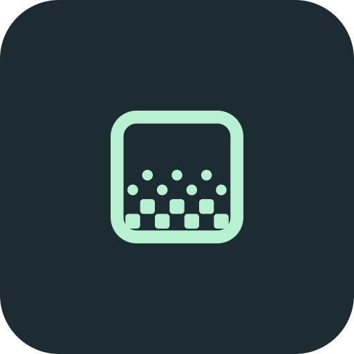

<p align="center">
  
</p>

<h1 align="center">AndroFuse</h1>

<p align="center">
  <a href="https://github.com/YuanZhe-99/AndroFuse/actions/workflows/ci.yml">
    
  </a>
</p>

<p align="center">
  <strong>Open-source Samsung DeX, Android phone mirroring, and independent Android app windows for Windows 11 (x64 &amp; native ARM64)</strong><br>
  Built with <a href="https://github.com/egoist/mygo">MyGo</a> native GPU (Direct3D 11) UI, Go orchestration, and a shared Rust core — no Root required.
</p>

---

> **Current Progress (`0.1.0` — M0–M4 Engineering & CI Infrastructure):** Wired USB & encrypted TLS Wi-Fi ADB Phone Mirroring, Native Samsung DeX loopback (`SemWifiDisplayConfig`), 30-second USB→Wi-Fi hot handoff, chromeless `vd_system_decorations=false` Independent App Windows with 96×96 app icons, WASAPI audio, bidirectional clipboard, PNG/MP4 capture, on-demand Built-in Headless Android VM (`internal/vm`), optional TLS 1.3 Android Companion (`arm64-v8a`, 16 KB aligned APK verified on `Pixel_9a_API_36`), userspace EasyTier `--no-tun` cross-network helper (`internal/mesh`), Ed25519 bundle signing (`internal/bundlesig`), native PE checks (`tools/checkpe`), and dual-architecture GitHub CI/Release workflows are implemented. Remaining hardware/soak gates are tracked in [PLAN.md](PLAN.md) and [platform-notes.md](doc/en-us/platform-notes.md).

[Project Plan (中文)](PLAN.md) · [Documentation (English)](doc/en-us/README.md) · [中文文档](doc/zh-cn/README.md)

## Implemented Work Modes & Capabilities

1. **Samsung DeX Desktop (`SemWifiDisplayConfig` Loopback + Honest Fallback)**:
   - Launches genuine Samsung Native DeX over wired USB ADB or encrypted TLS Wi-Fi ADB (`_adb-tls-connect._tcp`) with multi-window, taskbar, Recents, right-click/wheel/hover mouse behavior, dynamic resize (`RESIZE`), 30s grace-period USB→TLS Wi-Fi hot handoff (`dexhelper attach`), One UI version route selector, and transparent Virtual Display Compatibility fallback (`INV-06`).
   - *Note on Miracast*: Intentionally hidden and disabled across all platforms because third-party Windows Miracast sinks rely on undocumented `wlanapi.dll!WlanNotifyVsIeProviderInt`, which triggers kernel-mode `BugCheck 0x0000007E` (`qcwlan8280.sys`) on Windows 11 ARM64.
2. **Android Phone Mirroring (`Display 0`)**:
   - Direct Windows Media Foundation DXVA/D3D11 NV12 decoding straight into `ui.Bitmap.UpdateYUV` (`INV-04`, zero per-frame allocations), shared-mode WASAPI audio, bidirectional clipboard sync (`Ctrl+V` pre-sync), screen-off streaming (`SET_DISPLAY_POWER`), PNG screenshot (`SaveNV12AsPNG`), and zero-reencode fragmented MP4 recording (`MP4Recorder`).
3. **Independent App Windows (`vd_system_decorations=false` + `--flex-display`)**:
   - Extracts real localized app labels, `resizeMode`, and `96x96` PNG icons (`dexhelper apps`) into an App Launcher Grid; opens each Android app in a chromeless native Windows window with Snap Layouts 16 px-aligned scaling, taskbar/Alt+Tab presence, and hardware encoder headroom protection (`INV-01`).
4. **Built-in Downloadable Headless Android VM (`internal/vm`)**:
   - Optional on-demand provisioning under `%LOCALAPPDATA%\AndroFuse\vm\` using native host ABI (`arm64-v8a` on Win11 ARM64, `x86_64` on Win11 x64), booting headlessly (`-no-window`) so users without a physical phone can still run Independent App Windows.
5. **Optional Android Companion APK & Cross-Network (`internal/companion`, `internal/androidhost`, `internal/mesh`)**:
   - Base USB/Wi-Fi mirroring and DeX never require an APK (`INV-11`). Installing the optional `arm64-v8a` APK adds encrypted TLS 1.3 telemetry (battery, charging, temp), foreground app continuity, traversal-guarded SHA-256 file push, orphan display guard, and `_adb-tls-connect._tcp` dynamic port beaconing over LAN/VPN/userspace EasyTier (`--no-tun`, default off).
6. **Native ARM64 & x64 Verification & Release Signing**:
   - Enforces native PE `Machine` headers (`0xAA64` / `0x8664`) via `tools/checkpe`, Ed25519 helper bundle signing via `internal/bundlesig` + `tools/sign`, and same-user AF_UNIX NDJSON IPC via `androfuse-svc run` + `internal/localapi`.

## Quick Verification

```bash
gofmt -l cmd internal tools
go vet ./...
CGO_ENABLED=0 go test -count=1 ./...
go tool mygo vet .
go tool mygo i18n check
go run ./tools/checkdocs
cargo fmt --manifest-path core/Cargo.toml --all --check
cargo clippy --manifest-path core/Cargo.toml --workspace --all-targets -- -D warnings
cargo test --manifest-path core/Cargo.toml --workspace
cargo deny --manifest-path core/Cargo.toml check licenses bans sources
go run ./tools/checkpe -dir build -arch arm64
```

## Acknowledgments & Referenced Projects

AndroFuse stands on the shoulders of these open-source projects and technical references. We gratefully acknowledge their authors and communities:

| Project | License | How It Helped AndroFuse |
|---|---|---|
| **[MyGo](https://github.com/egoist/mygo)** | `MIT` | Native Direct3D 11 UI framework, `ui.Bitmap.UpdateYUV` NV12 GPU shader path, ARB localization (`mygo i18n`), and Windows/Android packaging |
| **[scrcpy](https://github.com/Genymobile/scrcpy)** | `Apache-2.0` | `scrcpy-server v5.0.1` wire protocol, `--flex-display`, `vd_system_decorations`, `/dev/uhid` pointer/keyboard injection, and raw audio streaming |
| **[ScrcpyDeX](https://github.com/Aureliano021/ScrcpyDex)** | `Apache-2.0` | Research reference demonstrating rootless Samsung `SemWifiDisplayConfig` loopback DeX activation (`127.0.0.1:7236`) via UID 2000 `app_process` |
| **[DX-Manager](https://github.com/maze-mei/DX-Manager)** | `MIT` | Reference for multi-session registries, One UI version probing, 30-second disconnect grace windows, and initial DPI ≥ 160 initialization rules |
| **[MyDeX](https://github.com/Keremerk/MyDeX)** | `MIT` | Empirical reference documenting One UI 7/8.5 virtual display boundaries (taskbar/Recents behavior) and plaintext `adb tcpip` security risks |
| **[DeXDesk](https://github.com/adirh3/DeXDesk)** | `MIT` | Research reference for Windows Miracast / Wi-Fi Direct Sink RTSP, RTP, MPEG-TS, UIBC, and Media Foundation DXVA pipelines |
| **[DeXter](https://github.com/fabriciolima77/DeXter)** | `GPL-3.0-or-later` | Research reference for mid-session USB → Wi-Fi ADB continuation ideas |
| **[Kyokai](https://github.com/YuanZhe-99/Kyokai)** | `AGPL-3.0-only` | Architecture reference (same author) for unified desktop+Android repo structure, `purego` C-ABI loading, AF_UNIX `localapi`, `checkdocs`, Ed25519 bundle signing, and GitHub CI/Release workflows (no AGPL RustDesk code is copied) |
| **[EasyTier](https://github.com/EasyTier/EasyTier)** | `LGPL-3.0` | Optional user-supplied external userspace (`--no-tun`) cross-network transport driven by `internal/mesh` (never bundled or statically linked) |
| **[purego](https://github.com/ebitengine/purego)** & **[windows-rs](https://github.com/microsoft/windows-rs)** | `Apache-2.0` / `MIT OR Apache-2.0` | Zero-cgo dynamic C-ABI loading (`androfuse_core.dll`) and native Rust bindings for Windows Media Foundation & WASAPI |

Commercial closed-source **AndroMeld** served strictly as high-level UX inspiration for independent app windows; zero APK, bytecode, code, or assets from AndroMeld are used or redistributed.

## License & Trademarks

AndroFuse is licensed under **GPL-3.0-only** ([LICENSE](LICENSE)). See [THIRD_PARTY_NOTICES.md](THIRD_PARTY_NOTICES.md) and [doc/en-us/third-party.md](doc/en-us/third-party.md) for complete attributions.

"Samsung", "Samsung DeX", "Galaxy", and "One UI" are trademarks of Samsung Electronics Co., Ltd. "Android" is a trademark of Google LLC. "Windows" is a trademark of Microsoft Corporation. AndroFuse is an independent open-source project.
